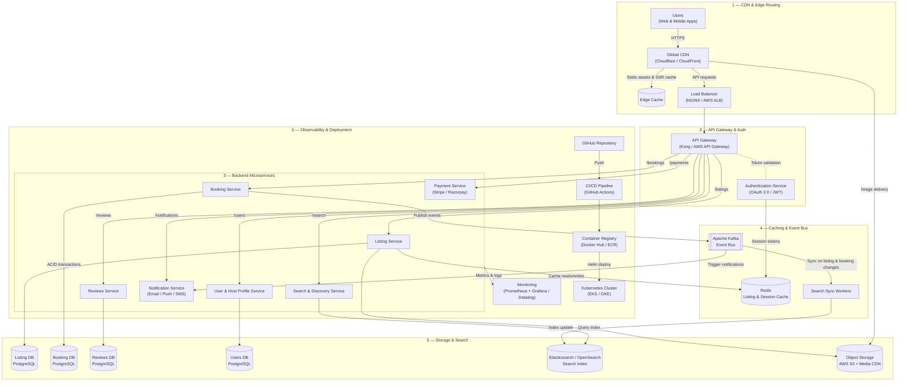

# Production-Scale Vacation Rental Marketplace — Architecture

> **Scope note:** This document covers two distinct layers:
> 1. **Implemented** — the React + Vite frontend-only assignment submitted.
> 2. **Proposed production architecture** — how this type of platform would scale in a real production environment (conceptual, not implemented in this assignment).

---

## 1. Overview

This project is a pixel-perfect, desktop-focused recreation of an Airbnb single-property listing page. It is a **purely frontend** implementation with no backend, database, or server component. All data is static and co-located with the source code.

The production architecture section below describes how a vacation-rental marketplace of this type — serving millions of concurrent users — would realistically be designed, deployed, and scaled.

---

## 2. Current Implementation Architecture

### Technology Stack (Implemented)

| Layer | Technology |
|---|---|
| UI Framework | React 19 |
| Build Tool | Vite 8 |
| Language | JavaScript (ES6+) |
| Styling | Vanilla CSS (component-scoped) |
| Icons | Lucide React |
| Routing | None (single-page, single-listing) |
| State | React `useState` / `useRef` (local + App-level) |
| Backend | None — all data is static |
| Database | None |
| Auth | None |

### App-Level State & Data Flow

All shared state lives in `App.jsx` — the single source of truth for booking, modal, and accessibility state.

```
App.jsx (root)
│
├── checkIn / checkOut  ──────────────────┐
├── guests                                │ Passed down as props
├── nights / totalPrice (derived)  ───────┤
│                                         │
├── photoTourOpen / photoTourCategory     │
├── lightboxOpen / lightboxImages / index │
├── srAnnouncement (aria-live)            │
└── openerRef (focus restoration)  ───────┘
```

Pricing constants are isolated in `src/constants/pricing.js` — a single source of truth shared between `App.jsx` (total derivation) and `BookingWidget.jsx` (line-item display).

### Component Tree

```
App.jsx
├── LiveRegion          (sr-only aria-live announcer)
├── Header              (fixed top navigation)
├── StickyScrollHeader  (scroll-activated, inert when hidden)
│
├── <main>
│   ├── TitleSection    (property title, rating, share/save)
│   ├── HeroGallery     (5-photo collage, opens Photo Tour on click)
│   │
│   └── ContentLayout   (two-column CSS grid: fluid left + 372px sticky right)
│       ├── [left column]
│       │   ├── PropertyHeader        (type, guest/bed/bath counts)
│       │   ├── GuestFavoriteBadge    (laurel badge, rating, review count)
│       │   ├── HostCard              (avatar, name, tenure)
│       │   ├── HighlightsList        (3 highlights with icons)
│       │   ├── DescriptionArea       (expandable listing description)
│       │   ├── SleepingArrangements  (horizontal-scroll card row)
│       │   ├── AmenitiesGrid         (2-col grid, show-all toggle)
│       │   └── AvailabilityCalendar  (2-month date picker, range validation)
│       │
│       └── [right column — sticky]
│           └── BookingWidget  (price, dates, guests, breakdown, reserve)
│
│   └── <div.listing-fullwidth>  (full-width sections, same container width)
│       ├── ReviewsSection    (ratings, filter chips, 2-col review cards)
│       ├── LocationSection   (embedded map, location description)
│       ├── MeetYourHost      (host card, stats, co-hosts, details)
│       ├── ThingsToKnow      (3-column house rules)
│       └── NearbyStays       (scroll carousel, 9 cards, pagination counter)
│
└── SiteFooter  (4-column links, bottom row, social icons)
│
├── PhotoTourModal  (React portal, sticky left nav, room image grid)
└── Lightbox        (React portal, full-screen, keyboard navigation)
```

### Hooks & Utilities

| File | Purpose |
|---|---|
| `src/hooks/useFocusTrap.js` | Traps keyboard focus inside open modal containers; restores focus on close |
| `src/constants/pricing.js` | Single-source pricing constants (`PRICE_PER_NIGHT`, `CLEANING_FEE`, `SERVICE_FEE`) |

### Key Implemented Interactions

| Interaction | Mechanism |
|---|---|
| Sticky header shows/hides on scroll | `scroll` event listener + `translateY` CSS transition |
| Sticky header blocks keyboard when hidden | HTML `inert` attribute |
| Photo Tour opens at specific room | `openPhotoTour(category)` sets category state in App |
| Lightbox opens from Photo Tour | Tour closes → `openLightbox(photos, idx)` in App |
| Focus restored on modal close | `openerRef` tracks trigger element; focus restored on close |
| Date range validation | `rangeContainsUnavailable()` walks blocked date set day-by-day |
| Screen reader announcements | `aria-live="polite"` region in App; inline `aria-live` in calendar |
| Calendar weekday headers | `<abbr title="Full name">` for unambiguous screen reader announcement |
| Thumbnail keyboard access | `<button>` wrappers with `aria-pressed` and `aria-label` |
| Body scroll lock | `document.body.style.overflow = 'hidden'` when any modal is open |

### Project File Structure (Actual)

```
PlayPowerAssignment/
│
├── src/
│   ├── assets/                   ← Property photos, logos, laurels (45 files)
│   ├── constants/
│   │   └── pricing.js            ← Shared pricing constants
│   ├── hooks/
│   │   └── useFocusTrap.js       ← Focus trap for modal dialogs
│   ├── components/
│   │   ├── layout/
│   │   │   ├── Header.jsx / .css
│   │   │   ├── StickyScrollHeader.jsx / .css
│   │   │   ├── ContentLayout.jsx / .css
│   │   │   └── SiteFooter.jsx / .css
│   │   ├── listing/
│   │   │   ├── TitleSection.jsx / .css
│   │   │   ├── HeroGallery.jsx / .css
│   │   │   ├── PropertyHeader.jsx / .css
│   │   │   ├── GuestFavoriteBadge.jsx / .css
│   │   │   ├── HostCard.jsx / .css
│   │   │   ├── HighlightsList.jsx / .css
│   │   │   ├── DescriptionArea.jsx / .css
│   │   │   ├── SleepingArrangements.jsx / .css
│   │   │   ├── AmenitiesGrid.jsx / .css
│   │   │   ├── AvailabilityCalendar.jsx / .css
│   │   │   ├── BookingWidget.jsx / .css
│   │   │   ├── ReviewsSection.jsx / .css
│   │   │   ├── LocationSection.jsx / .css
│   │   │   ├── MeetYourHost.jsx / .css
│   │   │   ├── ThingsToKnow.jsx / .css
│   │   │   └── NearbyStays.jsx / .css
│   │   └── modals/
│   │       ├── PhotoTourModal.jsx / .css
│   │       └── Lightbox.jsx / .css
│   ├── App.jsx / App.css
│   ├── index.css                 ← Design tokens, CSS reset, global styles
│   └── main.jsx
│
├── .agents/                      ← AI agent workspace rules and skills
│   ├── AGENTS.md
│   └── skills/
│       ├── interactive-verification/
│       └── layout-audit/
├── CLAUDE.md                     ← Claude AI secondary-tool documentation
├── AI_PROMPTS_LOG.txt            ← Full chronological prompt history (39 prompts)
├── architecture_diagram.md       ← This document
├── README.md                     ← Project overview and run instructions
├── package.json
├── vite.config.js
└── index.html
```

---

## 3. Production-Scale Architecture

> **Important:** None of the following is implemented in this assignment. This section describes a realistic production design for a vacation-rental marketplace operating at Airbnb-like scale.

### System Architecture Diagram



---

## 4. Main Backend Components (Production)

| Component | Responsibility |
|---|---|
| **API Gateway** | Rate limiting, SSL termination, auth token validation, request routing |
| **Listing Service** | CRUD for property listings, amenities, availability rules |
| **Search Service** | Query Elasticsearch; filter by location, price, dates, amenities |
| **Booking Service** | Create/cancel/modify reservations; enforce date availability atomically |
| **Reviews Service** | Submit, read, and aggregate ratings; prevent duplicate reviews |
| **User Service** | Host and guest profile management, ID verification |
| **Payment Service** | Charge guests, disburse to hosts; handle refunds per cancellation policy |
| **Notification Service** | Send booking confirmations, reminders, and messages via email/push/SMS |
| **Authentication Service** | OAuth 2.0 / social login; JWT issuance and rotation |

---

## 5. Data & Storage Strategy

| Data Type | Store | Rationale |
|---|---|---|
| Listings, bookings, reviews, users | PostgreSQL | ACID compliance for transactional integrity |
| Session tokens, listing cache | Redis | Sub-millisecond reads; TTL-based expiry |
| Property images | AWS S3 + CDN | Durable blob storage; CDN for global low-latency delivery |
| Search index | Elasticsearch | Full-text + geo-spatial + faceted filtering at scale |
| Event stream | Apache Kafka | Durable, replayable async communication between services |

**Read-path optimization:** The Listing Service writes to PostgreSQL as the primary source of truth. A Kafka consumer watches for listing mutations and updates Elasticsearch asynchronously, keeping search near-real-time without adding write latency.

**Write isolation:** The Booking Service uses row-level locking in PostgreSQL to prevent double-booking the same dates on the same property.

---

## 6. Caching Strategy

| Cache Layer | What is Cached | TTL |
|---|---|---|
| **CDN edge cache** | Static assets (JS, CSS, images), SSR HTML | Long-lived (hash-busted on deploy) |
| **Redis — listings** | Property detail pages (popular listings) | 5–10 minutes |
| **Redis — sessions** | Auth tokens, guest sessions | Session lifetime |
| **Redis — rate limits** | API request counters per user/IP | Per rolling window (60 seconds) |

---

## 7. Search Architecture

```
User query → API Gateway → Search Service → Elasticsearch query
  → Results ranked by: relevance + availability + price + rating
  → Booking Service consulted for real-time date availability filter
  → Results returned with listing summaries and CDN thumbnail URLs
```

Elasticsearch stores a **denormalized listing document** including: geo-point coordinates, price, amenities, rating, availability summary, and host language — avoiding joins at query time.

When a host updates their listing, a `listing.updated` Kafka event triggers a sync worker to re-index the document within seconds.

---

## 8. Image & Media Storage

```
1. Host uploads photo → API Gateway → Listing Service
2. Raw image stored in S3, resize job queued
3. Media worker generates multiple resolutions (thumbnail / medium / full)
4. All image URLs served through media CDN (CloudFront) globally
5. Frontend (Lightbox / Photo Tour) consumes CDN URLs directly
```

---

## 9. Scalability Approach

| Concern | Approach |
|---|---|
| Traffic spikes | Stateless microservices on Kubernetes; auto-scaling groups |
| Read-heavy listing pages | CDN + Redis caching eliminates DB hits for popular pages |
| Search at scale | Elasticsearch cluster with replica shards for read throughput |
| Database growth | Read replicas for queries; sharding by region or listing_id |
| Image delivery | CDN edge nodes in all major regions; no origin hits for repeated content |
| Real-time availability | Optimistic UI with server-side locking; polling/WebSocket for calendar sync |
| Cost efficiency | ISR for listing pages: rebuild only when listing data changes |

---

## 10. Reliability & Failure Considerations

| Scenario | Mitigation |
|---|---|
| Booking Service down | Booking attempts queue in Kafka; retry on recovery |
| Search Service unavailable | Degrade gracefully to category-browse mode; alert on-call |
| Database primary failure | Automatic failover to promoted read replica |
| Payment failure | Idempotent retry with unique booking token; clear user error |
| CDN cache poisoning | Content-Security-Policy headers; signed S3 URLs for private assets |
| DDoS / abuse | Cloudflare rate limiting + WAF at edge |

---

## 11. Deployment & CI/CD

```
Developer push → GitHub
  → GitHub Actions:
      1. Lint + unit tests
      2. Docker image build & push to ECR
      3. Helm chart deploy to Kubernetes (staging)
      4. Integration tests on staging
      5. Canary deploy: 5% of production traffic routed to new version
      6. Metrics pass → full rollout
      7. Metrics fail → automatic rollback
```

- **Environments:** `development → staging → production`
- **Infrastructure as Code:** Terraform manages cloud resources
- **Secrets management:** AWS Secrets Manager / HashiCorp Vault

---

## 12. Security Considerations

| Area | Approach |
|---|---|
| Authentication | OAuth 2.0 + short-lived JWT; refresh token rotation |
| Authorization | Service-level checks: guests cannot modify hosts' listings |
| API security | Rate limiting at Gateway; CORS policy; HTTPS enforced |
| Payment data | PCI-DSS compliant processor (Stripe/Razorpay); no raw card data stored |
| Image uploads | Virus scanning on S3 ingest; content-type validation |
| Injection attacks | Parameterized queries; ORM-enforced SQL; React DOM sanitization |
| XSS | React's DOM sanitization; strict CSP headers |

---

## 13. Key Request & Data Flows

### A. Listing Page Load
```
User browser → CDN (static JS/CSS)
  → Frontend API call → Gateway → Listing Service
  → Redis cache hit → listing data returned
  → (on cache miss) PostgreSQL → cache → return
  → Property images served via media CDN from S3
```

### B. Search
```
User types query → Frontend → Gateway → Search Service
  → Elasticsearch geo + filter query → ranked results
  → Frontend renders result cards with CDN thumbnail URLs
```

### C. Booking
```
User selects dates & reserves → Gateway → Booking Service
  → Check availability (PostgreSQL row lock)
  → Charge via Payment Service (Stripe)
  → Write booking record to DB
  → Emit `booking.confirmed` to Kafka
      → Notification Service: email/push to guest & host
      → Search Sync Worker: marks dates unavailable in Elasticsearch
```

### D. Image Delivery
```
User views listing → Frontend requests CDN image URL
  → CDN edge cache hit → image served from nearest PoP
  → (on miss) CDN fetches from S3 → caches at edge → serves
```

---

## 14. Trade-offs & Design Decisions

| Decision | Rationale |
|---|---|
| Microservices over monolith | Independent deployability and scaling per domain (booking vs. search) |
| PostgreSQL for all transactional data | ACID over eventual consistency is required for bookings and payments |
| Elasticsearch separate from primary DB | Purpose-built for the geo-spatial + multi-facet queries relational DBs handle poorly at scale |
| Kafka for service communication | Decouples services; durable replay if a consumer is temporarily unavailable |
| Redis over DB for sessions | Eliminates auth latency on every API request |
| CDN-first for images | Reads dominate; keeping origin load minimal is critical for cost and performance |
| Stateless services | Enables horizontal scaling without sticky-session complexity |

---

*This document was produced as part of the PlayPower Labs frontend engineering assignment.*
*The production architecture section is a conceptual design demonstrating production-scale thinking and is not implemented in the submitted code.*
